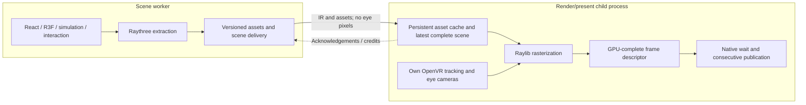

# Plan: an independent IR renderer and event-driven overlay presenter

Status: staged plan, 15 October 2026. An opt-in first implementation now exists; see
[implemented behavior, validation, and remaining gates](independent-renderer-implementation.md).
The acceptance criteria below remain the target, not a claim of completion.

Research context: [frame-pacing deep dive](deep-dive.md), especially the separate compositor
pose/texture snapshots, image ownership findings, and [VRChat measurements](natural-publication.md).

## Decision

Separate scene execution from a dedicated render/present owner. Send Raythree scene IR and
asset updates across that boundary. Keep graphics resources and eye images inside the renderer.
Let the renderer sample OpenVR tracking and choose its own eye cameras independently of the
WebXR simulation tick and the cameras included in the current legacy payload.

The renderer must continue drawing the latest complete scene snapshot from fresh tracking
when scene updates pause. A new scene update is useful data, not permission to render a frame.

Start with a dedicated child-process actor, following the existing desktop-view process
pattern. It contains one context-owning render thread and a small native wait-and-publish
function. This provides an independent JS heap/event loop and isolates native crashes. It
does not reserve CPU/GPU time or remove OS scheduling interference.

The renderer and presenter are two responsibilities within this owner, not two processes
exchanging eye images. No full-resolution eye-image readback, serialization, or actor message
belongs in the design.

## What success means

The first milestone is execution and camera independence. The production candidate adds
bounded transport, responsive tracked visuals, predictable lifecycle, and event-aligned
publication. Stronger image ownership is a subsequent gated milestone.

The project is not complete merely because the loop is faster. Public OpenVR still has separate
pose/texture setters and separate eyes. We have not established a public late-publication
rejection primitive or atomic stereo transaction. The architecture must expose those limits
rather than claim that a native function creates guarantees the compositor does not supply.

## Existing code to reuse and boundaries to change

### Historical precedent: the split existed before consolidation

Git history confirms that this is a return to a previous execution boundary, with additional
camera, cadence, ownership, and lifecycle requirements:

| Commit | Date | Change |
| --- | --- | --- |
| `45dc41e` — `raysan kami` | 2026-04-21 | Added `webxrOverlay.ts`: a separate actor receiving shadow-frame messages and owning raylib rendering/OpenVR presentation. |
| `23cf33a` — `use raythree` | 2026-04-22 | Replaced that handoff with Raythree IR; extraction stayed in `webxr`, rasterization/presentation in `webxrOverlay`. |
| `177d9b7` — `optimize` | 2026-04-26 | Added one-in-flight/latest-pending frame coalescing and render acknowledgements. |
| `f6a5995` — `unify rendering more` | 2026-05-10 | Removed the overlay actor's creation/dispatch/ack path and rendered/presented synchronously in `webxr`. The actor source itself remained. |
| `faf0e75` — `good state` | 2026-05-10 | Added the OpenVR-paced Raythree mode, with tracking refresh and rendering still inside `webxr`. |

Immediately before consolidation, the renderer used the eye views/projections in
`payload.frame` and rendered in the incoming `RENDERWEBXRRAYTHREEFRAME` handler. It had execution
separation, but no continuously running independent tracking/render loop. The old split is
therefore useful scaffolding, not the completed design to restore verbatim.

The consolidation commit explicitly logs “raylib overlay running in webxr worker hot loop.”
Its message gives no more detailed rationale; do not infer measured IPC overhead or a specific
failure as the reason for the change without additional evidence. Compare
`git show f6a5995^:petplay/webxr.ts`, `git show f6a5995^:petplay/webxrOverlay.ts`, and
`git show f6a5995 -- petplay/webxr.ts classes/webxrRaythreeScene.ts` when implementing the split.

### Current implementation map

| Area | Current state | Planned responsibility |
| --- | --- | --- |
| `petplay/webxr.ts` | Scene stepping, extraction, tracking refresh, raylib render, and publication share the worker. | Simulation/input-facing WebXR plus scene extraction and publication of IR. |
| `classes/webxrRaythreeScene.ts` | Extracts one eye-invariant scene; aliases it for the right eye; wraps legacy frame cameras. | Produce camera-independent scene snapshots and reliable asset updates. |
| `submodules/raythree/src/extract.ts` | No frustum filtering; extraction includes a camera but scene instances are independent of it. | Preserve extraction behavior; avoid a renderer dependency on the extracted camera. |
| `petplay/desktopView.ts` | Independent child-process IR consumer with its own graphics context. | Reuse the lifecycle/transport pattern; preserve its preview behavior. |
| `petplay/webxrOverlay.ts` | Dormant IR-rendering actor with old panorama presentation and pointer-based startup. | Replace or refactor into the new owner; do not revive its startup contract unchanged. |
| `classes/webxrOverlayRaylib.ts` | Owns targets; eye matrices are read from `payload.frame`. | Accept explicit renderer-owned eye cameras, retain targets and completion metadata locally. |
| `classes/webxrRaythreeRaylibRenderer.ts` | Accepts matrix overrides and performs view-dependent sorting. | Render scene IR with the supplied current render camera. |
| `classes/openVrOverlayFramePacing.ts` | Provides overlay tracking/prediction and existing timing policies. | Separate pose sampling/prediction from scene advancement and publication waiting. |
| `classes/openVrProjectionOverlays.ts` | TS wrapper issues consecutive OpenVR calls. | Remain an initial baseline; add a narrow native publication path. |
| `petplay/main.ts` | Supervises VR attachment and other child actors. | Start/stop/recover the render owner without rebuilding the scene. |

Candidate new modules: `classes/overlaySceneProtocol.ts`,
`classes/overlaySceneDelivery.ts`, `classes/overlayRenderFrame.ts`,
`classes/overlayPresenterNative.ts`, and a small buildable native presenter library.
Names are provisional; do not put production code inside the research tools directory.

## Ownership and execution model



The child initializes its own OpenVR overlay application and obtains its own interfaces.
Process-local OpenVR pointers, GL texture names, contexts, sync pointers, and raylib objects
must not be passed from the scene/server process as usable native objects. The existing dormant
actor's `overlayPointer` argument is not a cross-process contract to preserve.

The render thread owns the raylib context, render targets, renderer GPU cache, imported image
references, and publication calls. The native wait-and-publish function executes synchronously
on that context-owning thread. Deno's asynchronous FFI thread pool is not an interchangeable
place to run GL-dependent submission.

The scene retains authoritative application state and interaction decisions. Independent
render tracking does not create a second React tree, second simulation, or second spatial graph.

### Give simulation its own clock as well

Moving the raylib calls is insufficient if the scene still advances only because the render
pump calls `stepExternalFrame()` or acknowledges a frame. The scene worker must own its WebXR/
IWER and R3F advancement/extraction scheduler. It continues updating with the renderer absent,
slow, or stopped; render acknowledgements control delivery credits, never simulation time.

Use the existing input actors or an explicitly timestamped input feed for interaction poses.
Renderer tracking and simulation input can observe the same devices at different times without
requiring a rendezvous per frame. Any renderer-to-logic tracking feed is latest-state data,
not a call the renderer waits on before drawing. Neither loop waits for the other's frame ID.
Include `classes/webxrhost.ts` in the migration: remove the new mode's dependence on the old
external renderer-driven tick/unblock mechanism while preserving legacy behavior.

## Three identities, with explicit coordinate spaces

Do not reuse the current host frame counter as all three of these:

| Identity | Meaning |
| --- | --- |
| `sceneVersion` | Which simulation/IR snapshot supplies instances, lights, and UI state. |
| `renderFrameId` | Which eye images, views, projections, and GPU completion belong together. |
| `syncSequence` | Which successful runtime wait/progress event this presenter observed. |

Add a `sessionEpoch` for renderer/producer restart and an `originEpoch` for coordinate-space
changes. A rendered frame retains both epochs and its scene version. A reused scene version
may produce many different render frame IDs with different cameras.

The renderer computes eye views from one render tracking sample plus device eye transforms.
Both eyes use the same sampled tracking generation and explicit world/standing-space mapping.
If `worldFromStanding` is the scene's current origin transform, the conceptual eye transform is:

```text
worldFromEye = worldFromStanding × standingFromHead × headFromEye
eyeFromWorld = inverse(worldFromEye)
```

Store the exact views/projections used for rasterization in the resulting frame descriptor.
Submission uses those values. Never replace a completed image's tag with a newer head pose.
Freeze one origin revision across a stereo render. Define how scene coordinates are converted
to the tracking-origin coordinates expected by the OpenVR projection setter, and test a
non-identity origin so the identity case cannot conceal a mapping error.

Do not compare `performance.now()` values from different processes without establishing their
clock relationship. Use a common monotonic clock or a measured clock mapping for cross-process
age diagnostics; sequence IDs alone can establish ordering but not elapsed latency.

## IR delivery: coalesce scenes, retain dependencies

The current view protocol provides useful scaffolding, but it is not sufficient as-is:
asset batches are extractor deltas, instance buffers can be reused by the extractor, and a busy
view currently skips payloads. An asset introduced in a skipped payload must still reach the
renderer if a later scene references it.

Define two logical channels over the actor transport:

1. **Asset state:** versioned geometry, materials, texture resources, and removal information.
   Track acknowledged revisions and resend or resynchronize unacknowledged state. Do not
   blindly drop deltas when coalescing scenes.
2. **Scene snapshots:** latest complete instances/lights/UI/anchor state, with scene version,
   epochs, and required asset revisions. Replace superseded unadopted scene snapshots.

A snapshot is eligible only when its required asset revisions are available. Continue rendering
the previous complete snapshot while preparing dependencies. Commit a new scene and its asset
revision mapping together between render frames. Do not mutate the active scene halfway
through the two eye draws.

Initially, a conservative dependency table and a full cache resynchronization on restart are
preferable to a clever lossy protocol. Numeric asset IDs are scoped to a producer epoch;
restarting the extractor must not accidentally reinterpret old IDs. Retain old asset revisions
while referenced by active/staged snapshots; define removal and reclamation rather than grow
the existing union cache forever.

Use bounded credits: at most one scene delivery in flight plus one coalesced pending scene,
and bounded asset-transfer batches. Bound bytes as well as message count. Acknowledge asset
receipt/preparation separately from scene adoption and frame presentation. On overflow or a
missing dependency, request resynchronization or reject the new scene explicitly.

Start with the existing typed-array-capable child transport and measure serialization costs.
Copy/own the snapshot at the boundary so extractor reuse cannot change a queued frame. Do not
detach live Three.js buffers through transfer lists. SharedArrayBuffer is an optional later
optimization for compatible same-process workers, not an assumed cross-process IPC mechanism.

The IR can still contain large dynamic geometry and asset updates. No eye-image transfer does
not mean zero bandwidth: record bytes, allocation volume, transfer time, and backpressure.
Dynamic desktop/video textures need their own versioned resource-update path; keep existing
native desktop overlays on their existing path until integration is explicitly tested.

Keep a compatibility adapter for current desktop consumers that still expect
`WebXRRaythreeRenderPayload` and reference camera metadata. That metadata can remain useful
for a preview; the new overlay render loop does not use it as its camera or scheduling clock.

## Independent render cameras and tracked roots

The renderer uses its own OpenVR pose sample, prediction policy, and eye projections. It does
not ask WebXR to advance before rendering or wait for a matching host frame number. Keep
simulation tracking for interaction independent and timestamped. Rendering the same scene IR
from a new camera is normal behavior.

Audit prediction as a separate policy. Preparing a frame and publishing after a later sync can
change the intended display interval; do not carry over `extraPredictionFrames` blindly from
the old coupled/pipelined loop. Record prediction horizon and target-display estimate, then
validate under head rotation and translation. Do not use scene-app `WaitGetPoses` as the overlay
pacer; retain the public overlay tracking methods already used by the project.

World-anchored instances already support the main decoupling. Tracked visuals need additional
IR semantics because their current world matrices bake in simulation-time tracking. Introduce
explicit anchors such as `world`, `hmd`, `leftController`, and `rightController`, with a local
transform relative to that anchor. The renderer resolves tracked anchors from its render sample.

The extraction change must cover meshes, instance transforms, UI panels/text, normals, and
tracked lights where used. Flatten descendants relative to the tracked root, preserving authored
offsets, scale, and animation; do not apply a second tracking transform to already world-baked
matrices. Define how billboard/view-dependent effects are evaluated on the rendering side.

Interaction remains a simulation decision. Record the scene/input timestamps used for hit tests
so fresher visual controller placement is not mistaken for identical interaction timing. Test
grabbed objects, wrist menus, controller beams, and head-attached UI explicitly. Static-world
camera independence can land first behind a flag, but stale tracked visuals are not an
acceptable production regression.

## Render/present loop and native boundary

Use an explicit state machine, with bounded work outside the critical publication phase:

```text
drain bounded control/data work
→ adopt latest dependency-complete scene
→ sample renderer-owned tracking and freeze stereo camera/origin state
→ render into an eligible local target pair
→ establish GPU completion; create a prepared render-frame descriptor
→ native wait-and-publish
→ record result and advance reference handoff bookkeeping
→ yield to lifecycle/data handling and repeat
```

The loop repeats with the previous scene when no new snapshot arrives. If no new image is
GPU-ready, it may retain the last published frame for compositor reprojection; it must not
publish a new view for an old image. Avoid an unbounded FIFO of completed render frames.

The native call receives a prepared descriptor: image handles/type, exact eye views and
frusta, overlay handles, epochs, and a bounded wait policy. It performs no rendering, shader
compilation, actor dispatch, arbitrary JS callbacks, image allocation, or logging after the
wait returns and between setter calls. Precompute matrix layout/tangents before entering it.

Return a structured result including wait outcome, wait/publication timestamps, attempted
render frame ID, per-call result, and whether publication was partial. Keep measurements in
preallocated storage and aggregate outside the critical phase.

A successful event is phase alignment, not a reservation. The first implementation can use
the measured immediate-after-sync strategy, but must report that lateness handling remains
best effort. Do not present a fixed millisecond threshold or `GetFrameTiming` as a proven
all-workload admission fence. A failure after one setter has succeeded is a partial update;
it cannot be reported as a clean dropped frame or rolled back transactionally.

Keep waits bounded so lifecycle/control messages are serviced. A synchronous native wait
blocks this worker's JS event loop; receiving scene IR cannot depend on it running unboundedly.
Define cancellation/shutdown latency and add a native cancellation mechanism only if bounded
waits are insufficient. A timeout is a wait result, not an estimate of scene compute cost.

## Image ownership: two explicit implementation stages

### Stage A: isolate the existing graphics route

Keep raylib targets local and add producer completion/frame descriptors. Use the existing GL
submission as an instrumented baseline while proving independent execution and cameras.
Preserve the existing target bookkeeping and do not describe it as a proven compositor-safe
pool. The research found SteamVR can reuse a final shared image despite multiple source GL
textures; a local GPU fence does not complete the later internal Vulkan copy.

This stage isolates scheduling benefits from transport changes. It is a practical prototype,
not the final ownership argument. The legacy presentation mode remains selectable for rollback.

### Stage B: immutable direct imports on supported Linux setups

Render into compatible exportable images, complete producer GPU writes, import them through
the public DMA-BUF resource manager, and submit native shared handles. Published backing
allocations are immutable. Integrate the allocation as a real raylib render target, including
depth, framebuffer validity, texture orientation, and color-space behavior; the 16×16 probe is
not production integration code.

Use capability/format/modifier negotiation and explicit device selection. No CPU eye-image
readback/reupload is part of this path. If direct rendering requires an additional GPU copy,
measure and document it rather than label the path zero-copy without evidence.

Retain the previous producer import references until a successful post-publication FrameSync
has established the tested handoff progress. This may be the next iteration's successful wait;
track sequence/order explicitly rather than add an unnecessary wait per image. Do not release
the currently advertised image merely because its setter succeeded. Keep per-eye accounting
for partial publication. Consumer references/deferred destruction are not producer reuse fences.

Bound ready/pending producer work and account for renderer-owned targets, producer imports,
and compositor-deferred allocations separately. A stalled GPU can accumulate backend allocations
even when producer reference count is small. Stop further allocation/publication on unresolved
progress, apply memory-pressure policy, and report it. Do not invent a safe fixed-size reusable
pool without a demonstrated consumer retirement primitive.

At 3560×3560 RGBA8, one stereo color pair alone is about **96.7 MiB**, before depth and any
internal copies. Budget using real dimensions and formats. Test full-sized allocation/import
churn and stalled-consumer behavior before calling the tiny-image transport viable in production.

On unsupported setups, report the transport mode and its guarantees. An explicitly selected
legacy fallback can preserve usability; it must not silently claim immutable-image semantics.

## Lifecycle and recovery

The supervisor controls the renderer independently of the scene worker. Startup negotiates
protocol version and epochs, initializes the child's own runtime/graphics resources, registers
IR delivery, primes assets, and reports readiness. No visible overlay is published before a
complete render frame is available.

Scene-worker restart resets its producer epoch and triggers asset resynchronization. Renderer
restart invalidates all GPU/native state; it recreates its own resources and requests a complete
scene baseline without rebuilding React state. Do not serialize native handles into actor
snapshots and restore them as live resources.

Runtime quit/restart must stop publication, resolve or abandon pending state through ordered
client teardown, then attach as a fresh runtime session. Stop intake before destroying targets
or unloading interfaces. Coordinate shutdown with the existing main supervisor's ordered
detach rather than passing raw pointers through its old startup sequence.

Origin/recenter changes invalidate prepared frames from the previous origin epoch. Request a
consistent new mapping/snapshot; never fix an old image by retagging it. If the old coordinate
space is no longer meaningful, hide during recovery instead of displaying an incoherent frame.
Handle refresh-rate changes and tracking invalidity as explicit state transitions too.

Keep the process/actor inspectable: expose mode, epochs, scene/render/sync IDs, liveness,
capabilities, resource counts, last failure, and aggregate timing via normal health endpoints.
The desktop view must remain a separate consumer with its own camera policy.

## Implementation sequence and acceptance gates

### 1. Establish contracts and a repeatable baseline

- Preserve current behavior behind its existing mode; add a decoupled-renderer flag.
- Record current scene tick, extraction, render, publication, and memory metrics with persistent
  artifact storage. Label the active SteamVR build, transport, refresh rate, and VRChat state.
- Introduce protocol/frame types and the origin/session/version invariants above.

Acceptance: the proposed boundary is expressible without native pointers or eye pixel arrays
in IPC. Baseline artifacts survive process restart/reboot. No change to default presentation.

### 2. Make IR delivery correct under coalescing

- Implement asset revision acknowledgement, dependency-complete scene adoption, credits, and
  bounded scene replacement. Prime/reprime late or restarted consumers.
- Own snapshots across extraction-buffer reuse; retain existing desktop-view compatibility.

Acceptance: a scene referencing an asset introduced in a dropped intermediate snapshot renders
correctly; updates/removals and producer restart cannot resolve to stale asset IDs. Slow or
paused consumers do not grow an unbounded queue or block scene execution.

### 3. Start the separate render owner with independent cameras

- Refactor the dormant actor using the child-process lifecycle pattern and its own OpenVR init.
- Pass explicit render cameras into raylib instead of using `payload.frame` cameras.
- Run against the latest complete IR without stepping WebXR or waiting for new scene versions.
- Give the scene its own advancement/extraction scheduler; remove renderer acknowledgements
  and the external-pacer unblock as prerequisites for simulation progress in the new mode.

Acceptance: hold a static world scene version while the renderer advances through at least
several hundred frames; head motion remains responsive. Slow/pause scene updates while rendering
continues. Deliberately bias the legacy IR camera and verify the renderer ignores it. Test a
non-identity origin and both eyes. No eye-image IPC or duplicate scene execution occurs.
Conversely, pause/stop the renderer and verify scene simulation and input continue advancing.

### 4. Resolve tracked anchors on the render side

- Define/extract tracked-root local transforms; resolve them from the renderer sample.
- Cover UI, controller visuals, grabbed-object policies, and normal/world matrix handling.

Acceptance: with scene updates paused, world panels remain world-anchored, head menus follow
the head, and controller visuals follow the intended devices without double transforms. Resume
simulation and verify interaction/grabbing semantics and scene edits remain correct.

### 5. Add prepared-frame state and native event publication

- Add GPU completion bookkeeping and exact per-render camera tags.
- Implement the small synchronous native wait-and-publish entry point and structured outcomes.
- Remove the legacy 11–17 ms gate from the new mode only; retain it in the rollback mode.

Acceptance: traces show expensive work before the wait and no JS/actor work between successful
wake and setters. Timeout, invalid tracking, and partial failure produce distinct reported
outcomes. Renderer/control shutdown remains responsive. Repeat the generation-selection tests
against the native path, not just the standalone research publisher.

### 6. Integrate immutable transport and bounded handoff

- Implement direct exportable render targets, negotiated import, reference handoff, and memory
  accounting. Keep the GL baseline available for comparison.
- Validate small marker images first, then actual eye dimensions and render content.

Acceptance: distinct imported image generations and exact views are visible in captured draw
state; the positive output control reaches final output. Producer GPU completion precedes
publication. Handoff/retirement traces and full-resolution memory soak tests support bounded
normal operation, with explicit backpressure when progress stalls. No timer authorizes reuse.

### 7. Exercise lifecycle, workload, and rollout

- Run the matrix below, compare latency/cost, and document remaining coherence limits.
- Promote the decoupled mode only after tracked visuals, interaction, recovery, and memory gates
  pass. Remove legacy coupling/old actor paths in a separate cleanup after real use validates it.
- Update `docs/ARCHITECTURE.md` and `docs/PROJECTION_OVERLAYS.md` to describe the implemented
  topology and measured guarantees, not this planned topology as if it already exists.

Acceptance: scene pauses and renderer recovery are independent; the VRChat comparison is
repeatable; defaults/fallbacks are deliberate. No strict atomic stereo or late-wakeup guarantee
is claimed unless a new mechanism has actually established one.

## Validation matrix and telemetry

| Dimension | Required cases |
| --- | --- |
| Scene cadence | Static snapshot, slower-than-display updates, bursty updates, paused producer, resumed producer. |
| Assets | Late join, skipped intermediate scene with new assets, texture/material revision, removal, large update, epoch reset. |
| Tracking | Rotation, translation, controllers, tracking loss, recenter, non-identity origin, valid recovery. |
| Runtime workload | SteamVR baseline, VRChat home world, representative heavier VRChat world, scene startup/transition. |
| Scheduling | Delayed scene worker, delayed renderer before wait, delayed worker after successful wait, native setter interruption control. |
| Graphics | Small visible marker, ordinary content, both eyes at intended resolution, GL baseline, supported direct import, unsupported capabilities. |
| Lifecycle | Stop while waiting, scene reload, renderer crash/restart, SteamVR quit/restart, graphics reset where safely testable. |

Automated tests should target protocol state transitions and failure modes: dependency retention,
epoch changes, bounded queues, camera/frame identity, native result handling, and handoff order.
Do not substitute mocks for actual GL/OpenVR synchronization tests or write tests that merely
repeat setter implementation order. Native/GPU tests need the real runtime and persistent logs.

Collect scene age/adoption rate, renderer FPS, render frame/scene/sync IDs, prediction horizon,
GPU-ready time, wait duration/result, wake-to-publication duration, publication duration,
partial updates, invalid tracking, and memory/resource counts. Log per-frame details to bounded
preallocated buffers only when tracing; summarize outside the critical phase.
Record effective child scheduling policy/priority too; a new process must not silently inherit
an idle policy and invalidate workload comparisons. Do not introduce real-time scheduling or
system permission changes as an implicit dependency of this migration.

Use matching-generation CPU probes to locate natural crossings. Use GPU capture separately to
verify descriptors/constants and output, accounting for capture timing perturbation. Subjective
headset smoothness is valuable but not equivalent to either measurement. Trace loss, timeouts,
skipped generations, and failed runs must be retained and reported, not counted as successes.

The initial 0/1020 immediate-after-sync CPU result is a useful comparison target, not an
acceptance proof for all PCs. Headsets at other refresh rates and other GPUs remain explicit
validation work, and a home-world run does not stand in for a crowded VRChat instance.

## Scope and outstanding correctness questions

This plan does not rewrite the renderer in C++, duplicate the scene graph, move eye pixels
through actor messages, add private compositor hooks, or commit to shared-memory IR transport
before measuring IPC. It preserves the public-API preference.

Still unresolved by this architecture alone:

- The compositor can read a prior view and a later image even when both producer setters finish
  between the reads. Native publication reduces exposure but cannot make those reads atomic.
- A successful `WaitFrameSync` can become stale after a scheduling delay. A reliable public
  pre-publication rejection condition has not been established.
- Two independent projection overlays are not a demonstrated atomic stereo transaction.
- The observed post-publication reference handoff and deferred destruction need validation in
  the production-size transport, and do not expose permission to rewrite a published image.

Any stricter solution requiring another layer API or version-checked native integration is a
separate design decision. These limitations must remain visible in rollout criteria.
