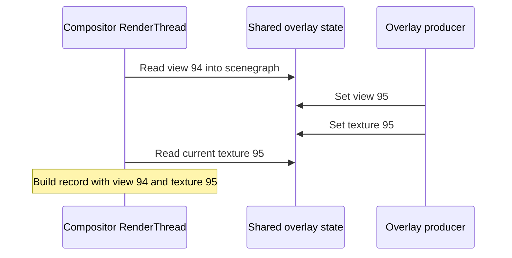

# SteamVR overlay frame pacing: a reverse-engineering deep dive

Research conducted on 13–14 October 2026; synthesis written on 15 October 2026.

What started as “why does this overlay occasionally judder?” turned into an investigation of
SteamVR's shared memory, texture caches, GL/Vulkan interop, compositor snapshots, GPU resource
retirement, and the meaning of `WaitFrameSync`.

The practical goal is straightforward: present a projection overlay whose image and view matrix
belong to the same rendered frame, without choosing a magic millisecond window for one PC.
Prefer public OpenVR APIs, and document any guarantee they cannot provide.

We have a promising event-driven direction. We do **not** yet have a complete presenter proven
correct across machines, workloads, missed wakeups, and both eyes.

## The findings worth taking away

1. **Projection pose and texture are collected separately.** In the inspected Linux compositor,
   the view matrix is copied into the scenegraph under one shared lock. The current texture is
   selected later under another lock. A complete, very fast producer update can fit between
   those reads and still produce a mixed-generation selection.
2. **Application GL texture pooling does not establish compositor image pooling.** The ordinary
   GL submission path has intermediate resources and another Vulkan copy. We observed one
   unchanged final shared image per eye despite changing application texture IDs.
3. **`WaitFrameSync` is useful.** Publishing a prepared image immediately after it returned gave
   zero mixed CPU selections in the short tests, including VRChat's home world. It signals
   compositor progress; it is not an atomic pose/texture transaction or a GPU retirement fence.
4. **Immutable imported images give us a stronger ownership model.** Public Linux DMA-BUF
   import preserved distinct images and bypassed the ordinary GL path's extra client copy.
   Producer GPU completion and compositor-side deferred destruction were separately observed.
5. **A delayed worker can lose the benefit of the event.** Deliberately delaying publication
   after a successful wait reintroduced mixed selections. A portable design still needs an
   answer for late publication and independent left/right updates.

The evidence comes from several different levels. API returns, CPU selections, captured draw
state, and final output are identified separately throughout this article.

## What we were trying to stabilize

[PetPlay](../what-petplay-is.md) includes a Linux SteamVR overlay application. Its UI is rendered
as stereo eye images through a WebXR/raylib path. Those images need to remain stable while the
user moves their head, including while VRChat is the scene application.

The earlier presentation path packed the eyes into a head-locked stereo panorama. Prediction
error then moves the image with the head. Projection overlays offer a better fit: provide the
image, the view it was rendered from, its frustum, and the eye, and let the compositor reproject
it toward the displayed head orientation.

On our setup, freezing a correctly configured projection overlay and moving the head left the
image stable under rotation. That was an important control: reprojection worked, yet updating
the image and transform could reintroduce jumps. Without depth, this is not a promise of correct
reprojection for arbitrary head translation.

There is also a geometry trap. `SetOverlayTransformProjection` takes a
**tracking-origin-to-eye view matrix**, represented as a row-major 3×4. It does not take the
eye-to-world pose used by ordinary absolute overlays. PetPlay already supplies the view matrix.
One later diagnostic initially got this wrong; its output test had to be repeated.

The implementation and earlier geometry experiments are described in
[PROJECTION_OVERLAYS.md](../../docs/PROJECTION_OVERLAYS.md). Some passages there and in the early
research notes describe the state of knowledge at the time; the synthesis here includes the
subsequent corrections.

## Four problems hiding inside “frame pacing”

It helped to stop treating pacing as one question:

| Requirement | What has to be true |
| --- | --- |
| Producer completion | The GPU has finished writing the image before the compositor can consume it. |
| Image/view coherence | The selected image and its projection view describe one generation. |
| Lifetime and retirement | Published backing memory survives consumer use; future writes do not overwrite a live read. |
| Stereo publication | The two eyes become eligible as one coherent frame, including when the producer stalls. |

A smooth loop can satisfy these most of the time without exposing why. An event can improve
phase alignment without making publication transactional. A producer fence can finish new
rendering without establishing when the previous consumer has finished.

We wanted to know which of those properties the runtime actually supplied.

## The first useful workaround: present later

Early headset experiments tried freezing the overlay, changing the tagged pose by one frame,
double-buffering the application textures, calling `glFinish`, and changing setter order.
Freezing was stable; changing buffers or setter order did not remove the problem. Delaying
publication to a consistent later phase made a substantial difference, at additional latency.

The temporary policy became an **11–17 ms** present window in the application's vsync-based
clock at **75 Hz**. A **12–17 ms** comparison was subjectively better, with occasional judder
remaining. Those are observations from this setup, not transferable recommendations.

Built-in SteamVR tracing gave some context. With tracefs writable, the runtime emitted markers
such as `NewFrame`, `DrawOverlays`, `Present`, GPU work finished, and client texture submission.
One capture gave these phases relative to the selected HMD vblank:

| Marker | Median | p5–p95 |
| --- | ---: | ---: |
| Compositor `NewFrame` | 4.8 ms | 3.1–6.7 ms |
| `DrawOverlays` | 5.6 ms | 3.7–7.5 ms |
| `LateLatchHmdPose` | 6.3 ms | 4.1–8.2 ms |
| `Present` begin / overlay sync signaling | 7.6 ms | 6.3–9.4 ms |
| GPU work finished | 8.3 ms | 6.9–10.3 ms |

That made the later window understandable, but it supplied no all-workload guarantee. GPU
completion maxima exceeded the percentile, and both refresh rate and workload matter.

We also found a real bug in the temporary gate: it checked the deadline before waiting for the
window to open, but did not check again after a late wake. Before the fix, two 20-second runs
each admitted one start after the 17 ms deadline; the latest starts were about 23.9 and 20.9 ms.
The fix rechecks after waiting. Subsequent captures admitted no starts beyond that deadline.
Workload changed between runs, so changes in drop counts were not a controlled comparison.

That fixes a local admission bug. It does not make several OpenVR setters atomic, bound their
completion time, or prove that the window is correct for another machine.

See [client events and the present deadline](client-events-and-pacing.md).

## Following the two publication paths

The investigation combined public API probes, Ghidra, `objdump`, runtime vtable inspection,
Linux uprobes, tracefs markers, and eventually RenderDoc. Frida was considered, but the CPU
questions could be answered without loosening ptrace restrictions.

### Projection transforms go straight to shared memory

In the inspected client, `SetOverlayTransformProjection` takes a shared-state guard and writes
the transform type, projection shape, matrix, and frustum into the overlay slot. There is no
texture-switch-style IPC operation on this path.

### Textures use a ring, with backend-dependent preparation

The slot contains a five-entry texture ring. A direct native shared texture and an ordinary GL
texture do not follow identical preparation paths. The ring's current handle and bounds are
published under the shared guard after the relevant preparation.

An early hypothesis treated message **`0x201`** as a command that made another compositor thread
switch textures. Following the event object corrected that: it is
`VREvent_OverlaySharedTextureChanged`—decimal 513—inserted into a shared event ring. The
notification can be conditional. It is not evidence for the hypothesized texture-switch IPC.

The separate consumer snapshots explain the race without that hypothesis.

### The compositor does not take one original-state snapshot

The relevant path is:

```text
PrepareForFrame
  → PushUpdatesToScenegraph
      → acquire shared guard
      → copy projection view into scenegraph
      → release guard

ComputeSystemLayerParams / BuildRenderLists
  → acquire shared guard again
  → select current texture-ring handle
  → combine it with the already prepared scenegraph transform
  → release guard
```

The final render record contains an image and a transform together. That does not mean their
original shared-state reads happened together.

In an early production trace, the two eyes each had **749 paired reads**. Median read gaps were
approximately **0.24–0.26 ms**, with a maximum around **2.13 ms**. API-publication counts crossed
those gaps. At that stage we could establish the CPU timing mechanism, but not identify the
sampled pixel generation: the selected final image handle stayed constant per eye.

See [compositor snapshots](compositor-snapshot.md) and
[the event-path correction](client-events-and-pacing.md).

## Why “just make both calls fast” is not a complete answer

Later tests assigned a unique matrix to every pose generation and a unique immutable shared
handle to every image generation. That let us identify actual CPU selections, rather than
compare counts of API calls.

Here is one measured crossing, with monotonic timestamps:

```text
55371.296513  compositor reads pose generation 94
55371.296572  producer starts the setters for generation 95
55371.296589  producer finishes both setters
55371.296630  compositor selects texture generation 95
```

The whole pair took **17 microseconds**, entirely inside a **117 microsecond** consumer read
gap. There was no deliberate stall, logging, rendering, or trace-marker syscall between those
setters. Markers bracketed the pair; the uprobes themselves still perturb execution.

The result is old pose plus new texture even though the producer finished both updates before
the compositor's second read. Reversing the setters does not prevent this ordering either.



In fact, even a hypothetical atomic producer update would not, by itself, make these two
consumer reads a transaction. The update could still land between them.

This establishes a mechanism an implementation can hit. It does not establish that every
application hits it visibly, or that every residual PetPlay judder has this one cause.

## The second surprise: our GL pool was not the compositor's image pool

The original handoff assumed that different application GL texture IDs meant different shared
images, ruling out image overwrite. The traces contradicted that assumption.

On the ordinary GL route, the observed path was approximately:

```text
application GL texture
  → GL blit into an interop scratch image
  → GL semaphore signal and flush, or fallback glFinish
  → another client-side Vulkan image copy
  → final shared image advertised in the overlay ring
```

That last copy matters. Calling `glFinish` before `SetOverlayTexture` completes earlier producer
GL work; it does not wait for a Vulkan copy that the client queues later inside submission.

We observed one constant final shared handle per production eye despite changing pooled GL
sources. In an isolated test, changing GL sources, clearing the overlay texture, and even
destroying/recreating the overlay reused the same final image. Those operations were not a
verified fresh-allocation strategy on this route and build.

The client Vulkan copy waited on its GL input semaphore and signaled a completion semaphore.
The compositor's observed ongoing final submissions did **not** include the two mapped overlay
image completion semaphores in their explicit wait lists. We mapped identities inside the
compositor process rather than comparing raw Vulkan handle numbers across devices.

That is a meaningful negative result about the observed submit path. It is not a proof that
all driver dependencies are absent, that a particular frame sampled an incomplete copy, or
that we demonstrated a GPU use-after-free. Image layout and queue-family barriers found in
the code also must not be mistaken for a completed host wait or a consumer retirement fence.

See [compositor semaphores](compositor-semaphores.md) and
[ownership and publication](ownership-and-publication.md).

## What `WaitFrameSync` actually buys us

Valve's [public header](https://github.com/ValveSoftware/openvr/blob/master/headers/openvr.h)
describes `WaitFrameSync` as a way to synchronize with the runtime's update rate. In the
inspected implementation, ordinary clients wait on a pair of alternating overlay-vsync events.

The normal compositor path signals after CPU collection and GPU submission, **before GPU work
has necessarily completed**. A closer audit found the client selects the reset/inactive event
under the shared-state guard. That is useful progress synchronization, rather than simply
waiting on an arbitrary already-signaled event.

This suggests a different loop from “wake, do all rendering, eventually submit”:

```text
prepare an image and its matching view
→ complete the producer GPU writes
→ wait for runtime frame sync
→ promptly publish the prepared generation
```

It puts the expensive work before the phase-alignment event. It still supplies no reservation
that prevents the publishing thread from being descheduled afterward.

### The tempting latch API was a dead end

The runtime's newer `IVROverlay_029` vtable also exposed a `WaitLatchSync` method. The compositor
created its pair of overlay-latched events, which initially looked like exactly the missing
primitive. But the inspected binary had no signaling path for those events, and the live probe
timed out. Finding a method name and event construction was not enough.

The two additions over `_028` were that method and a shared-handle getter; neither was a
batched texture-plus-projection setter. The getter's index semantics were not fully resolved,
so we did not promote it into a consumption acknowledgement.

### A timeout is not a compute-budget measurement

Even a sub-millisecond compute loop can encounter frame-duration wait timeouts without
exceeding its compute budget. The timeout is an integer number of milliseconds, so a nominal
**8.333 ms** frame period at 120 Hz may become **8 ms**, depending on bindings
and conversion. Scheduling/runtime jitter can matter too. Valve also explicitly warns that
signals may be dropped in non-async mode due to scene application performance.

Adding timeout headroom does not postpone an event that arrives earlier: a successful wait
returns when signaled. It is different from sleeping an extra millisecond before publication.
Conversely, fewer timeouts do not prove that pose and texture were collected coherently.

For diagnostics, measure compute time, GPU completion, wait duration/result, and publication
timing separately. A timeout means the wait did not complete within its bound; it is not
permission to treat the frame as synchronized or to recycle memory.

## The ownership route that looks more tractable: immutable DMA-BUF images

The public Linux resource-manager interface offered a way around the ordinary GL copy/cache
path: `IVRIPCResourceManagerClient_003::ImportDmabuf`, followed by `SetOverlayTexture` with
`TextureType_SharedTextureHandle`.

Our diagnostic allocates a fresh GBM image, imports it into EGL/GL for rendering, writes its
generation marker, creates and flushes a GL fence, and waits for that fence to complete before
OpenVR import/publication. It never renders into the published allocation again.

The direct route preserved distinct compositor image identities and made zero calls to the
ordinary internal client Vulkan copy helper in the observed tests. It lets us separate producer
completion from subsequent ownership transfer much more cleanly.

This is a Linux candidate, not a cross-platform implementation. The probe used an AMD RX 7900
XTX and an explicitly supported linear ARGB8888 DMA-BUF modifier. Production needs format and
modifier negotiation, device selection, capability handling, and an allocation strategy that
does not turn a stalled consumer into unbounded memory growth.

### Releasing a reference is not the same as reusing memory

The import API duplicates the supplied FD, allowing the producer to close its copy. That does
not imply the currently advertised imported resource can be unreferenced immediately after
the setter returns.

| Reference strategy | Observed result |
| --- | --- |
| Unref the current image immediately after submission | Calls succeeded, but selected handles were not successfully imported by the compositor. |
| Unref the previous image immediately after replacement | Paced runs worked; a rapid run exposed a selected handle with a null imported wrapper. |
| Replace, wait for a successful post-publication FrameSync, then unref the previous producer import | Passed the observed handoff and reclamation tests. |

The last sequence retains a producer reference while the compositor progresses through the
handoff. It is a tested candidate, not a documented public per-image acknowledgement.
It also does not tell the producer when an old allocation becomes writable again. We avoid
that question in this experiment by never reusing a published allocation.

The before-publication wait used for phase alignment and the after-publication wait used in
the handoff test serve different purposes. They should not be conflated.

### We followed destruction through to the backing memory

An imported wrapper being destroyed is not enough to prove safe memory retirement. We traced
the backend image, its advancing last-use timeline, deferred release, completion query, and
eventual matching Vulkan allocation free.

In a 32-generation run, the first generation was skipped and **31 actual imports** were
identified. All 31 matching allocations were freed after successful queries for their recorded
completion points. In a held-image control, each of three images received **17 advancing
last-use marks** before its allocation was freed after the final point completed.

This supports the observed immutable direct-import lifetime path. It does not prove every
import variant, device-loss path, stalled-GPU memory bound, or a public producer reuse fence.

See [image lifetime](image-lifetime.md) and
[GPU publication handoff and allocation retirement](gpu-publication-handoff.md).

## Other ways we tried to manufacture a transaction

### Pinning images with `AcquireOverlayView`

Public overlay views really could pin a ring image in the tested GL configuration. Submit red,
acquire/read red, then submit green repeatedly: the held view remained red. But reacquiring
from the same process and overlay moved its pin to the new image; the older view was no longer
protected simply because `ReleaseOverlayView` had not yet been called.

Different overlay handles retained independent pins. Those were producer/view-reader pins,
not compositor consumer fences. The DMA-BUF images also failed the attempted GL view reader
with `InvalidTexture` in this configuration, despite successful compositor import.

### Immutable overlay banks

Two banks could keep image/view generations immutable, then switch visibility. Actual
visibility and projection view were collected under the same scenegraph guard, which made this
worth testing. But public Show/Hide calls are separate operations.

Deliberately interrupting a bank switch exposed both banks, neither bank, or different banks
for left and right. Finishing quickly reduces exposure; it does not make the switch atomic.
These were transparent CPU-publication controls, not screenshots of visible doubled images.

### One parent controlling both eyes

Subview overlays looked like a possible single visibility gate. Parent Show/Hide did group
selection, but the compositor also made both children inherit the parent's projection shape
and prepared matrix. The children did not retain independent left/right projection state,
even though their projection setters succeeded and getters reported projection type.

That is not a usable transaction for independently projected stereo eyes.

### Mirror access, clearing, and frame telemetry

The tested public GL mirror path returned no importable mirror image; the client shared mirror
handle was zero. Its access lock/unlock methods were no-ops in the inspected binary, so they
were not a retirement fence even if import could be made to work elsewhere.

`ClearOverlayTexture` cleared publication state on the inspected path, without a demonstrated
GPU completion wait. A larger `GetFrameTiming` frame index was not a fence either: timing-ring
publication could precede current GPU completion and was not one-for-one with display frames.

The public compositor image-dump request reached the render thread, but the selected Linux
implementation ignored the output filename and performed synchronization plumbing rather than
writing images. These findings concern the inspected paths, not every platform/configuration.

See [bank publication](bank-publication.md), [parent projection](parent-projection.md), and
[public output-capture audit](output-capture.md).

## Moving from CPU state to actual GPU draws

CPU handles and known producer pixels do not prove what a compositor draw sampled. We therefore
used a private, launch-time RenderDoc 1.46 Vulkan layer and matching replay SDK helpers. The
package was unpacked rather than installed globally; the normal SteamVR fixes layer was retained.

The first compositor-only restart left old clients/server resources referring to the previous
compositor and produced a black headset. That invalidated it as a normal-output control. A
full runtime restart recovered the display, and subsequent capture sessions started the full
runtime together. The original launcher and normal environment were restored afterward.

There were two more diagnostic corrections: reconnecting to RenderDoc can deliver old capture
notifications, and a projection diagnostic initially supplied the wrong transform convention.
We added explicit last-frame checks, validated distinct successive captures, corrected the view
matrix, and repeated the output test. A black intermediate or an old capture filename must not
become evidence for a rendering mechanism.

The final corrected projection-only test deliberately held three states:

| Captured frame | Texture generation | View generation | Draw / sampled-image resource |
| --- | ---: | ---: | --- |
| 1145 | 0 | 0 | 173 / 4599 |
| 1277 | 0 | 1 | 173 / 4599 |
| 1412 | 1 | 1 | 173 / 4959 |

The descriptor image pixels identified the texture generation. The draw's 624-byte constant
block identified the view generation, matching selected submitted rotation components within
about **5.1e-7**. A broad green diagnostic patch also reached the resolved intermediate and
final lens-distorted left-eye output. The right eye retained the ordinary scene.

This verifies a real projection draw with new view constants and an old immutable image under
an intentionally separated update. It validates our ability to distinguish generations; it is
not a measurement of the frequency of naturally occurring races. RenderDoc also changes
execution timing, so its frame durations were not used as ordinary pacing measurements.

Replay included other scene artifacts. We did not attribute them to the publication mechanism.
Source RGB bytes also change through final color/distortion processing, so exact producer RGB
matching is not a sufficient final-output classifier.

See [initial GPU capture](gpu-capture.md) and
[the corrected clean-runtime capture](clean-gpu-capture.md).

## Normal consecutive updates, including VRChat

After validating generation identification, we returned to the normal compositor and used
CPU probes with transparent diagnostic overlays. Every pose had a unique matrix, every image
a distinct imported shared handle, and images were finished before publication.

We captured the 12 source matrix floats at the compositor pose read and the advertised handle
at texture selection, pairing them within one scenegraph update. Accepted traces had no lost
entries and no unclassified reads. These are **CPU generation selections**, not RenderDoc
captures of the same natural crossings or direct measurements of visible judder.

Each short run published 256 images. Unsynchronized runs used a 7 ms diagnostic spacing to
exercise changing phase; synchronized runs published promptly after the runtime wait.

| Workload | Publication | Mixed / classified frame pairs |
| --- | --- | ---: |
| Before VRChat launch | Unsynchronized, view first | 2 / 155 |
| Before VRChat launch | Unsynchronized, texture first | 6 / 153 |
| Before VRChat launch | After FrameSync, view first | 0 / 255 |
| Before VRChat launch | After FrameSync, texture first | 0 / 255 |
| VRChat initial/home world | Unsynchronized, view first | 7 / 165 |
| VRChat initial/home world | Unsynchronized, texture first | 5 / 160 |
| VRChat initial/home world | After FrameSync, view first | 0 / 255 |
| VRChat initial/home world | After FrameSync, texture first | 0 / 255 |

The user confirmed the home world was loaded and working. Public compositor queries identified
VRChat as the active scene process in the synchronized runs. Beginning/end timing snapshots in
one run showed scene GPU times of about **6.49/9.53 ms** and client intervals of **7.18/17.57 ms**.
Those are context snapshots, not percentiles or a crowded-world benchmark.

Across the immediate-after-wait runs there were **zero mixed selections in 1,020 classified
frame pairs**, half of those with VRChat running. This is encouraging evidence for the event-
aligned candidate. It is not a statistical independence claim or an all-workload guarantee.

### The late-publication control

With VRChat still in its home world, we deliberately varied the delay after a successful wait
over approximately 0–20 ms. The two setters remained consecutive. This modeled a late worker;
the delay was neither a proposed pacing rule nor a measured real-world stall distribution.

Over 768 published images, we observed **5 mixed selections in 1,111 classified frame pairs**.
Three entire setter pairs completed between the compositor reads. One example:

```text
55789.356306  FrameSync wait completes
55789.367887  compositor reads view generation 264
55789.367939  producer starts generation 265 setters
55789.367962  producer finishes both setters
55789.367965  compositor selects texture generation 265
```

So success from the wait is useful phase information **at the time of the wakeup**. It does not
reserve a future safe interval. The observed roughly 11 ms offsets are not another portable
threshold to hardcode.

A separate retry overlapped VRChat startup and hit a one-second wait timeout. It was excluded
from the steady-state comparison. Another long trace overflowed and was rejected; the accepted
late-worker capture had all **245,213** written entries retained. Temporary trace buffer changes
were restored on exit.

See [consecutive publication and VRChat measurements](natural-publication.md).

## Why another fast overlay can look fine

An overlay with a short update loop, prompt event-aligned publication, or a different transform
and graphics-backend path can work very well. Our own immediate-after-wait results agree with
that practical experience. A fixed-transform quad also does not keep changing the projection
view that describes the rendered pixels in the way PetPlay's stereo projection path does.

The narrower result is that speed alone does not create an API guarantee. We measured complete
setter pairs fitting between separate consumer reads, and a late-worker control defeating
otherwise successful event alignment. Whether that matters to another application requires
examining its actual path and workload.

## Where this leaves the presenter design

The strongest candidate direction currently has these properties:

1. Keep each rendered image coupled to the exact view used to render it.
2. Finish producer GPU work through an actual completion primitive before publication.
3. Prefer immutable imported images on the tested Linux path, rather than infer compositor
   allocation identity from application GL texture IDs.
4. Prepare expensive work before waiting; use runtime frame sync to align a short publication
   phase instead of a hardcoded elapsed-vsync window.
5. Keep producer references through a demonstrated handoff boundary. Treat timeout as failure
   to establish progress, and bound pending work instead of continually allocating.
6. Keep late-wakeup handling and coherent stereo publication explicit unresolved requirements.

This has not replaced PetPlay's production presenter. It also leaves performance engineering:
full-sized eye images, allocation/import churn, format/modifier negotiation, and heavier worlds
need testing. A safe 16×16 transport probe is not a finished high-resolution presenter.

The next highest-value questions are:

- Is there a public observable that can reliably reject a publication whose event wakeup has
  become stale, before either setter changes shared state? `GetFrameTiming` has not supplied
  that guarantee, and checking elapsed time alone reintroduces a workload-dependent assumption.
- Can a coherent two-eye protocol be built from public operations, or must that limitation be
  accepted/documented? Ordinary setters and the tested bank/parent schemes did not provide it.
- How does the candidate behave over long runs in crowded or GPU/CPU-heavy VRChat worlds,
  across refresh rates and GPUs, and during scene/runtime transitions?

If strict guarantees require a different layer API or version-checked native integration, that
needs to be stated as a different design choice. It is not an already-approved public-API fix.

## Scope, reproducibility, and the inconvenient evidence gap

The main target was Linux SteamVR on an AMD RX 7900 XTX with a 75 Hz headset configuration.
Important inspected binary identities were:

| Binary | ELF BuildID |
| --- | --- |
| `vrcompositor` | `f5c560dcaa16d7b2625ece684b02396505e0768f` |
| `vrclient.so` | `c3439e6dd64f87cc2b451764611189cd788d037e` |

Addresses in the detailed notes are ELF virtual addresses; executable uprobe file offsets in
these binaries subtract `0x1000`. That rule is not a universal mapping for every segment or
another build. Ghidra also incorrectly marked lock helpers as no-return, truncating callers;
we repaired analysis and checked the assembly rather than trust missing decompiler tails.

The [tools directory](tools/) contains the source probes, capture helpers, and analyzers. They
include build-specific addresses and machine-specific dependencies; they are research tools,
not a supported generic tracing package. Tracefs must already be available with suitable access.
The generation runner checks BuildIDs and restores its tracing/buffer state.

For the consecutive-setter experiment, from the repository root after building the GPU probe
against matching OpenVR headers and the local GBM/EGL/GL libraries:

```sh
PP_GPU_POSE_CURRENT=1 PP_GPU_POSE_GENERATIONS=1 PP_GPU_UNIQUE_POSES=1 \
PP_DMABUF_GENERATIONS=256 PP_DMABUF_STAGE_MS=7 \
  bash markdown/projection-overlay-re/tools/generation-read-probe.sh \
  /persistent/evidence/unsynchronized /path/to/dmabuf-gpu-probe

python3 markdown/projection-overlay-re/tools/generation-read-summary.py \
  /persistent/evidence/unsynchronized
```

Use `PP_GPU_TEXTURE_FIRST=1` for the other order. For the immediate-after-wait comparison, set
`PP_GPU_WAIT_BEFORE_PUBLISH=1` and `PP_DMABUF_STAGE_MS=0`. The intentionally delayed control
additionally sets `PP_GPU_AFTER_SYNC_JITTER_US=20000`; that is a test stimulus, not a tuning value.
Create the evidence directory first. A timeout or trace loss must be reported, not silently
folded into successful-run statistics. Full commands for the other experiments live alongside
their detailed notes.

There is an important limitation to sharing this write-up: much of the raw evidence was saved
in session `/tmp` directories. By 15 October the main scratch directory was gone and tracefs
permissions had reset. **The repository contains methods, source tools, and recorded results;
it does not contain the original trace/RenderDoc archive.** The later numerical summaries were
preserved from successful tool outputs in the investigation chat and cannot currently be
recomputed from those original files.

Future replications should save accepted raw traces, API logs, capture identities, analysis
outputs, runtime configuration, and checksums to a persistent evidence directory before a
reboot. Private IDs, paths, and unrelated application data need review before sharing captures.
The tables here are reported measurements with that provenance limitation, not an independently
replayable artifact release.

## Reading map

| Topic | Detailed investigation |
| --- | --- |
| Original map and address reference | [README](README.md) |
| Split consumer snapshots and GL ring correction | [Compositor snapshots](compositor-snapshot.md) |
| Notification path, interface versions, deadline bug | [Client events and pacing](client-events-and-pacing.md) |
| GL/Vulkan copies and observed submit waits | [Compositor semaphores](compositor-semaphores.md) |
| View pins, mirror locks, timing telemetry | [Ownership and publication](ownership-and-publication.md) |
| Partial bank swaps | [Bank publication](bank-publication.md) |
| Parent/subview projection inheritance | [Parent projection](parent-projection.md) |
| GL cache reuse and direct DMA-BUF imports | [Image lifetime](image-lifetime.md) |
| GPU fences, reference handoff, actual allocation frees | [GPU publication handoff](gpu-publication-handoff.md) |
| Public mirror/dump limitations | [Output capture](output-capture.md) |
| Initial RenderDoc session and recovery | [GPU capture](gpu-capture.md) |
| Corrected draw-state and final-output controls | [Clean GPU capture](clean-gpu-capture.md) |
| Consecutive setters, waits, and VRChat | [Natural publication](natural-publication.md) |

External API references: Valve's [OpenVR header](https://github.com/ValveSoftware/openvr/blob/master/headers/openvr.h),
the [RenderDoc replay API used by the helpers](https://github.com/baldurk/renderdoc/tree/v1.46/renderdoc/api/replay),
and Khronos's [Vulkan FD memory-import rules](https://docs.vulkan.org/refpages/latest/refpages/source/VkImportMemoryFdInfoKHR.html).
